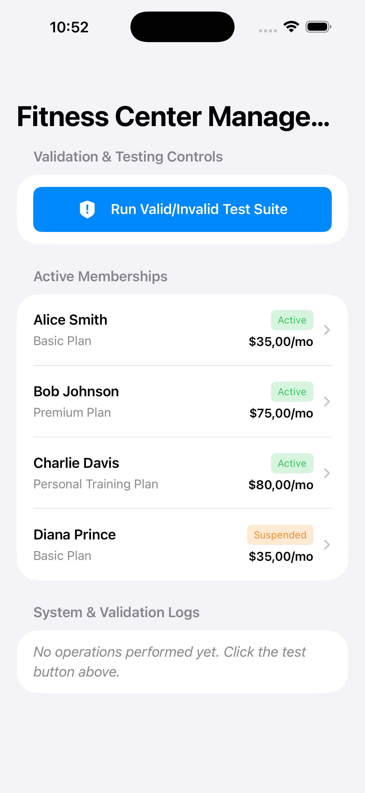
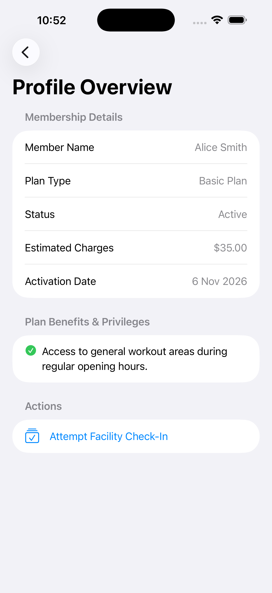
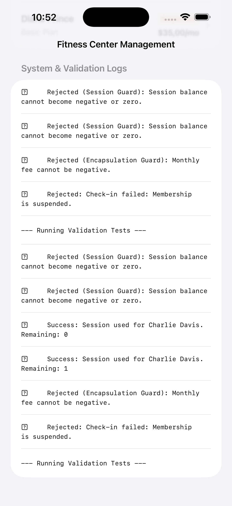

//
//  README.md
//  Fitness_Membership
//
//  Created by SESEIU24007 on 6/11/26.
//

import Foundation
# Lab 7 - Assignment 3 - Fitness Center Membership Management System
**Course:** iOS Programming Fundamentals with Swift  
**Lecturer:** Truong Thi Ngoc Phuong  

---

## 📸 App Screenshots & Validation Evidence

### 1. Main Directory & Benefits View

### 2. Profile Details & Calculation Breakdown

### 3. Rejection Test Evidence (Validation Guard Active)

---

## 🛠 Project Structure
- `EnumsAndErrors.swift` - Domain enums (`MembershipStatus`, `MembershipType`) & custom validation errors (`MembershipError`)
- `MembershipModels.swift` - Core class model hierarchy (`Membership` base class, `BasicMembership`, `PremiumMembership`, `PersonalTrainingMembership`) with encapsulation, inheritance, & polymorphism
- `FitnessCenterViewModel.swift` - ObservableObject managing app state, membership directory, & automated validation test suites
- `Views.swift` - SwiftUI user interface components (`ContentView` & `MembershipDetailView`)
