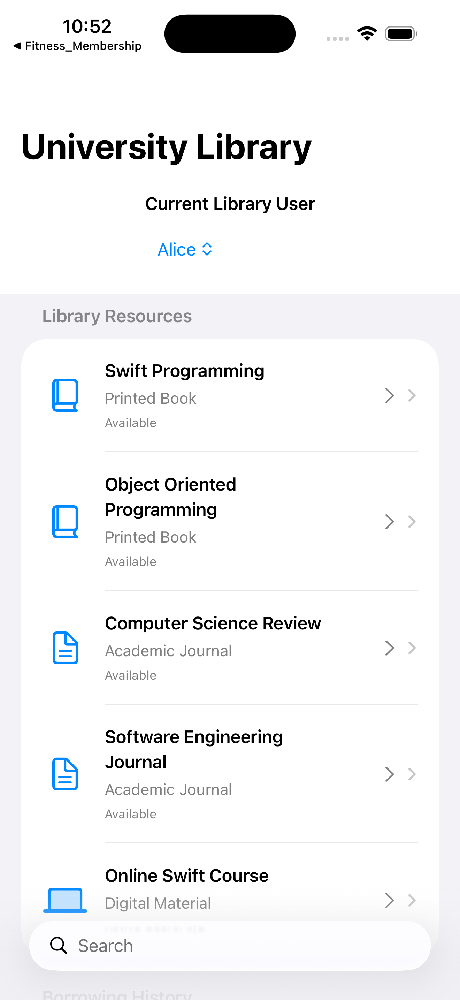
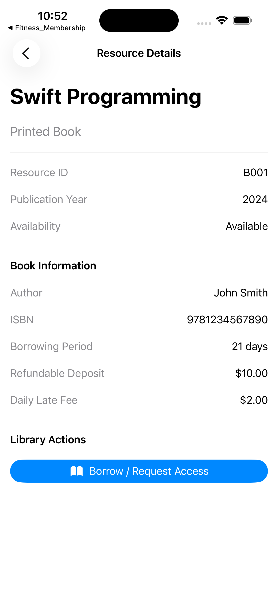
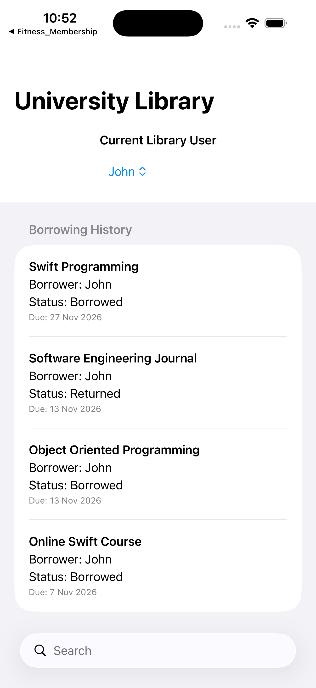

# Lab 7 - Assignment 1 - Library Resource Management System
**Course:** iOS Programming Fundamentals with Swift  
**Lecturer:** Truong Thi Ngoc Phuong

---

## 📸 App Screenshots & Validation Evidence

### 1. Main Directory & Benefits View

### 2. Profile Details & Calculation Breakdown

### 3. Rejection Test Evidence (Validation Guard Active)

---

## 🛠 Project Structure
- `EnumsAndErrors.swift` - Domain enums (`ResourceStatus`, `ResourceType`) & custom validation errors (`LibraryError`)
- `LibraryModels.swift` - Core class model hierarchy (`LibraryResource` base class, `PrintedBook`, `AcademicJournal`, `DigitalMaterial`) with encapsulation, inheritance, & polymorphism
- `LibraryViewModel.swift` - ObservableObject managing app state, resource directory, & automated validation test suites
- `Views.swift` - SwiftUI user interface components (`ContentView` & `ResourceDetailView`)
