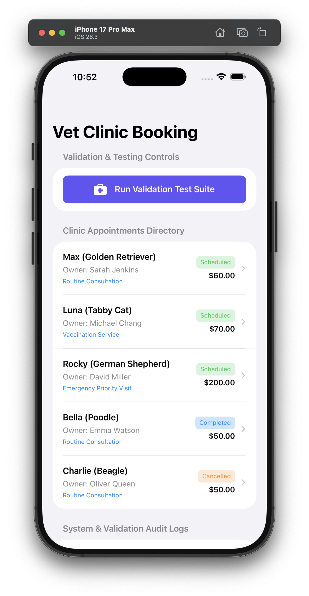
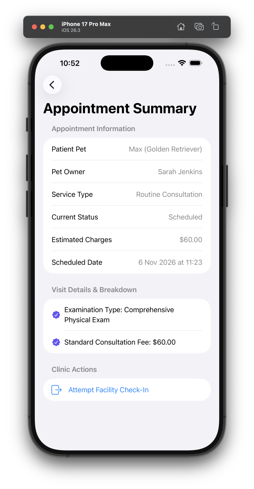
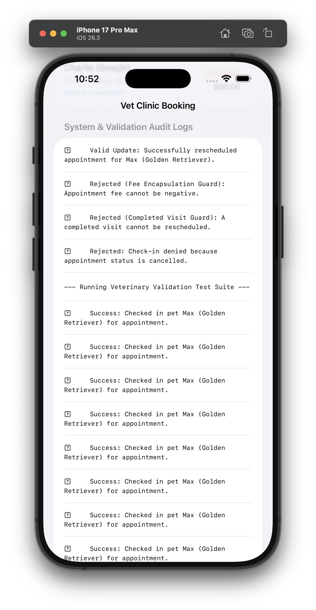

# Lab 7 - Assignment 4 - Veterinary Clinic Appointment Management System
**Course:** iOS Programming Fundamentals with Swift  
**Lecturer:** Truong Thi Ngoc Phuong  

---

## 📸 App Screenshots & Validation Evidence

### 1. Main Directory & Benefits 

### 2. Profile Details & Calculation Breakdown

### 3. Rejection Test Evidence (Validation Guard Active)

---

## 🛠 Project Structure
- `EnumsAndErrors.swift` - Domain enums (`AppointmentStatus`) & custom validation errors (`AppointmentError`)
- `AppointmentModels.swift` - Core class model hierarchy (`Appointment` base class, `RoutineConsultationAppointment`, `VaccinationAppointment`, `EmergencyAppointment`) with encapsulation, inheritance, & polymorphism
- `ClinicViewModel.swift` - ObservableObject managing app state, appointment bookings, & automated validation test suites
- `Views.swift` - SwiftUI user interface components (`ContentView` & `AppointmentDetailView`)
